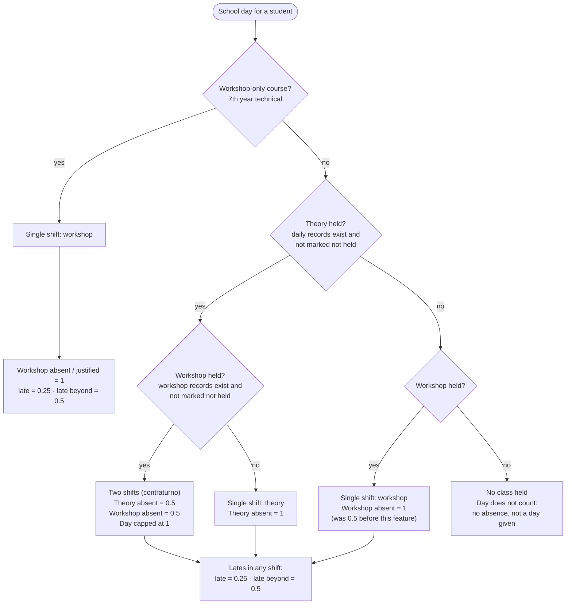
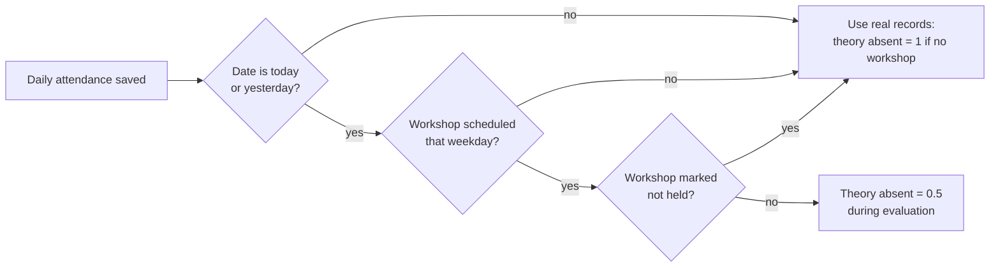

# Attendance: how much an absence weighs

Institutional absence counting per PBA Res. 1650/2024, Anexo 4, as implemented in
`apps/api/src/modules/attendance/domain/services/weighted-absence.ts`.

> Status: the "class not held" marker (theory or workshop) is being built in
> `feat/class-not-held` (`odd/tasks/class-not-held.md`). The weight rule for it is
> already in the domain function; wiring the marker into callers is pending.

## Core rules

- A school day never weighs more than **1** (`MAX_DAILY_ABSENCE`).
- With two shifts that day (theory + workshop, "contraturno"), each shift weighs **1/2**.
- With a single shift that day, that shift weighs **1**.
- A **justified** absence weighs the same as an absence (section 24): it still counts.
- A **late** arrival weighs **0.25**; **late beyond tolerance** weighs **0.5**, whatever the number of shifts.
- **Present** weighs 0.
- A shift **is held** only when it has records (or, from this feature on, it is not marked "not held"). A shift with no records does not exist for the count.
- The daily (theory) shift is counted first; the workshop adds only up to the day cap of 1.
- Yearly cap: **28** (`INSTITUTIONAL_ABSENCE_CAP`). Alerts at 10, 20 and the cap.

## Which day is it?

## All cases (regular course with workshop)

`A` absent or justified · `L` late · `LB` late beyond tolerance · `P` present · `—` shift not held.

| # | Theory held | Workshop held | Theory | Workshop | Day total |
|---|---|---|---|---|---|
| 1 | yes | yes | P | P | 0 |
| 2 | yes | yes | A | P | 0.5 |
| 3 | yes | yes | P | A | 0.5 |
| 4 | yes | yes | A | A | 1 |
| 5 | yes | yes | L | P | 0.25 |
| 6 | yes | yes | LB | P | 0.5 |
| 7 | yes | yes | L | A | 0.75 |
| 8 | yes | yes | LB | A | 1 |
| 9 | yes | yes | A | L | 0.75 |
| 10 | yes | yes | A | LB | 1 |
| 11 | yes | no | A | — | 1 |
| 12 | yes | no | L | — | 0.25 |
| 13 | yes | no | LB | — | 0.5 |
| 14 | no | yes | — | A | **1** (new; was 0.5) |
| 15 | no | yes | — | L | 0.25 |
| 16 | no | yes | — | LB | 0.5 |
| 17 | no | no | — | — | 0 (day not counted) |

Workshop-only course: the workshop is the only shift, so absent = 1, late = 0.25,
late beyond = 0.5.

## Why "not held" is a class marker, not a student status

If the absence of a teacher were stored as a status on each student, the day would
have records and would count as held: it would add a day given and keep the
contraturno halving. A marker on the class (course + date for theory, workshop
commission + date for workshop) keeps the rule "records exist ⇒ the shift was held".

Marking a shift as not held deletes the records already saved for that day (the UI
asks for confirmation) and blocks registering new ones until it is unmarked.

## Alert evaluation (special case)

The daily attendance is usually saved before the workshop one. So, while evaluating
alerts for **today or yesterday**, a day whose commission has a workshop scheduled
that weekday counts as contraturno even before the workshop records exist: a theory
absence weighs 0.5 meanwhile. This avoids raising a permanent alert that would be
wrong once the workshop is taken.

The "workshop marked not held" check is part of this feature (pending). Report and
student totals always use the real records, never this exception.

Alerts already raised are not recomputed if a later marker lowers a total.
