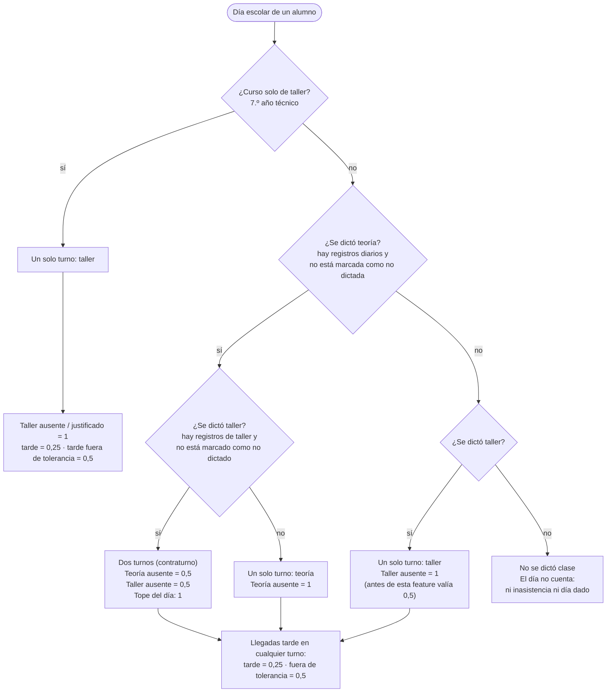
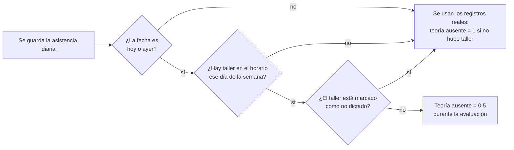

# Asistencia: cuánto vale una inasistencia

Cómputo institucional de inasistencias según la Res. 1650/2024 de la PBA, Anexo 4,
tal como está implementado en
`apps/api/src/modules/attendance/domain/services/weighted-absence.ts`.

> Estado: la marca de "clase no dictada" (teoría o taller) se está construyendo en
> `feat/class-not-held` (`odd/tasks/class-not-held.md`). La regla de pesos y los
> endpoints para marcar ya existen en la API; falta conectar la marca con los
> cálculos, las alertas y los reportes, y la pantalla web.

## Reglas base

- Un día escolar nunca vale más de **1** (`MAX_DAILY_ABSENCE`).
- Si ese día hubo dos turnos (teoría + taller, "contraturno"), cada turno vale **1/2**.
- Si ese día hubo un solo turno, ese turno vale **1**.
- Una inasistencia **justificada** vale lo mismo que una inasistencia (punto 24): sigue contando.
- Una **llegada tarde** vale **0,25**; una **llegada tarde fuera de tolerancia** vale **0,5**, sin importar cuántos turnos hubo.
- **Presente** vale 0.
- Un turno **se dictó** solo si tiene registros y no está marcado como no dictado. Un turno sin registros no existe para el cómputo.
- Primero se cuenta el turno de teoría; el taller suma solo hasta completar el tope de 1 del día.
- Tope anual: **28** (`INSTITUTIONAL_ABSENCE_CAP`). Alertas en 10, 20 y el tope.

## ¿Qué tipo de día es?

## Todos los casos (curso común con taller)

`A` ausente o justificado · `T` tarde · `TF` tarde fuera de tolerancia · `P` presente · `—` turno no dictado.

| # | ¿Teoría dictada? | ¿Taller dictado? | Teoría | Taller | Total del día |
|---|---|---|---|---|---|
| 1 | sí | sí | P | P | 0 |
| 2 | sí | sí | A | P | 0,5 |
| 3 | sí | sí | P | A | 0,5 |
| 4 | sí | sí | A | A | 1 |
| 5 | sí | sí | T | P | 0,25 |
| 6 | sí | sí | TF | P | 0,5 |
| 7 | sí | sí | T | A | 0,75 |
| 8 | sí | sí | TF | A | 1 |
| 9 | sí | sí | A | T | 0,75 |
| 10 | sí | sí | A | TF | 1 |
| 11 | sí | no | A | — | 1 |
| 12 | sí | no | T | — | 0,25 |
| 13 | sí | no | TF | — | 0,5 |
| 14 | no | sí | — | A | **1** (nuevo; antes 0,5) |
| 15 | no | sí | — | T | 0,25 |
| 16 | no | sí | — | TF | 0,5 |
| 17 | no | no | — | — | 0 (el día no cuenta) |

Curso solo de taller: el taller es el único turno, así que ausente = 1, tarde = 0,25 y
tarde fuera de tolerancia = 0,5.

Una suspensión institucional que abarca el turno del curso también cuenta como
"teoría no dictada": si ese día hubo taller, una inasistencia al taller vale 1.

## Por qué "no dictada" es una marca de la clase y no un estado del alumno

Si la ausencia del docente se guardara como un estado en cada alumno, el día tendría
registros y contaría como dictado: sumaría un día dado y mantendría la mitad del
contraturno. Una marca en la clase (curso + fecha para teoría, comisión de taller +
fecha para taller) conserva la regla "si hay registros, el turno se dictó".

Al marcar un turno como no dictado se borran los registros ya cargados de ese día
(la pantalla pide confirmación) y no se pueden cargar nuevos hasta desmarcarlo.
Desmarcar no recupera los registros borrados.

## Evaluación de alertas (caso especial)

La asistencia diaria suele cargarse antes que la de taller. Por eso, al evaluar
alertas de **hoy o ayer**, un día en que la comisión tiene taller en el horario
cuenta como contraturno aunque todavía no haya registros de taller: mientras tanto,
una inasistencia a teoría vale 0,5. Así se evita disparar una alerta permanente que
dejaría de ser correcta en cuanto se tome el taller.

La verificación "taller marcado como no dictado" es parte de esta feature
(pendiente). Los totales de los reportes y de la ficha del alumno siempre usan los
registros reales, nunca esta excepción.

Las alertas ya disparadas no se recalculan si una marca posterior baja el total.
